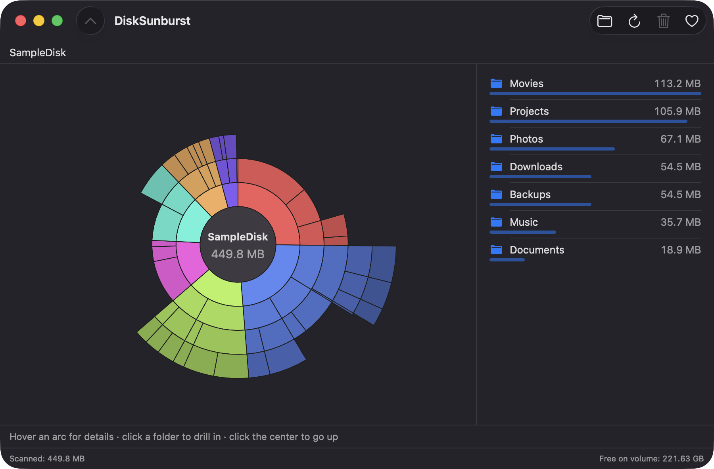
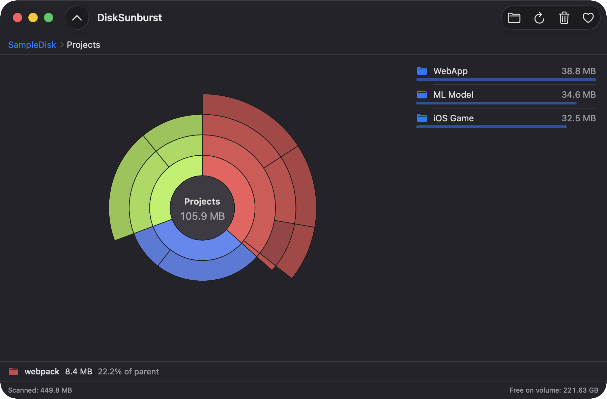
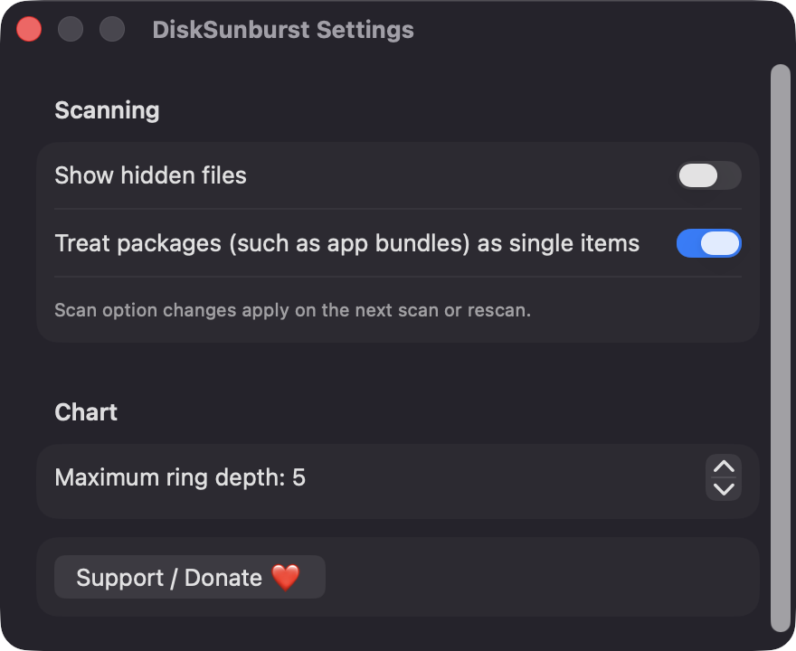

# DiskSunburst

**🌐 Website:** [turhe123.github.io/disk-sunburst](https://turhe123.github.io/disk-sunburst/)

Scan a folder or drive and see what eats your space in an interactive sunburst chart, then reveal or trash it.


## Why

DiskSunburst is a free, open-source, 100% native, backend-free alternative to paid utilities in the *Files & Conversion* category. It was inspired by DaisyDisk ($9.99 one-time), which popularised the concentric-ring view of disk usage. DiskSunburst covers the core loop only: scan, see, drill down, clean up. It is written in SwiftUI and AppKit, with no server and no accounts.

## Features

- **Background scan** of any folder or volume, or your home folder in one click. It sums allocated (on-disk) file sizes, and the chart updates live while the scan runs.
- **Interactive sunburst chart** drawn in a SwiftUI Canvas. The center is the scanned folder, each ring is one level deeper, and each arc's angle is proportional to its size.
- **Hover** an arc to see its name, size and share of its parent in a footer.
- **Drill down** by clicking a folder arc, which makes it the new center. Click the center, press Esc, or use the breadcrumb to go back up.
- **Largest-items list** beside the chart, with size bars. Double-click a folder to drill in.
- **Actions** on the selected item: Reveal in Finder, Open, Copy Path, and Move to Trash after a confirmation. The Trash is recoverable, and the scan root itself can't be trashed.
- **Colors**: one hue per top-level branch, with lightness changing by depth. Items under 1% are merged into a gray "Smaller items" arc.
- **Drag and drop** a folder onto the window to scan it.
- **Careful scanning**: symbolic links are skipped, hard links are counted once, and system volume paths such as `/Volumes` are skipped. Each folder keeps its 300 largest children plus one aggregate "other items" entry.
- **Unreadable folders** are counted and shown in the status bar, with a shortcut to the Full Disk Access settings.
- **Status bar** with the scanned total and the free space on the volume. A Cancel button stops a running scan.
- **Settings**: show hidden files, treat packages (app bundles) as single items, and maximum ring depth (2–8, default 5).
- **Keyboard shortcuts**: ⌘O choose folder, ⌘R rescan, ⇧⌘R reveal in Finder, ⌘↓ open, ⇧⌘C copy path, Delete move to Trash, Esc up one level.

## Screenshots

<p align="center"></p>

<p align="center"><em>A scanned folder shown as an interactive sunburst, with one color per top-level folder and a size-sorted list of the largest items beside it.</em></p>

<p align="center"></p>

<p align="center"><em>Drilled into the Projects folder: the breadcrumb tracks your path and hovering an arc shows its name, size and share of its parent.</em></p>

<p align="center"></p>

<p align="center"><em>Settings for showing hidden files, treating app bundles as single items, and choosing the maximum ring depth.</em></p>

## Install

1. Download `DiskSunburst-macOS.zip` from https://github.com/turhe123/disk-sunburst/releases/latest.
2. Unzip it and move `DiskSunburst.app` to `/Applications`.
3. The app is open source and not notarized, so clear the quarantine flag:

   ```bash
   xattr -cr /Applications/DiskSunburst.app
   ```

4. Right-click the app and choose **Open** the first time you launch it.

## Build from source

Requires Xcode (macOS 14+ SDK) and [XcodeGen](https://github.com/yonaskolb/XcodeGen).

```bash
brew install xcodegen
xcodegen generate
xcodebuild -project DiskSunburst.xcodeproj -scheme DiskSunburst -configuration Release -derivedDataPath ./build build
```

The app is produced at `build/Build/Products/Release/DiskSunburst.app`.

## Permissions

DiskSunburst does not request Accessibility, Screen Recording, Microphone, Camera or network access, and the code contains no use of them. The only permissions involved are the standard macOS file-access ones:

- **Files and folders** (Desktop, Documents, Downloads, removable volumes): macOS shows its usual privacy prompt the first time one of these is read during a scan.
- **Full Disk Access** (optional): needed only to scan protected locations or a whole disk. Grant it manually in System Settings › Privacy & Security. The app has a button that opens that pane. Without it, unreadable folders are counted and reported, and the scan continues.

## Built with AI

DiskSunburst was written by [Claude Code](https://claude.com/claude-code) inside an automated pipeline, from a plain-English spec. No code, binaries or assets from any commercial app were used; it is a clean-room reimplementation of a feature set, not a copy.

What that means in practice:

- The full source is in this repo under the MIT license. Read it before you run it.
- No network calls, no analytics, no third-party dependencies. Only Apple frameworks.
- Ad-hoc signed and not notarized, which is why Gatekeeper warns on first launch.
- It has had less human review than a hand-written app. Bug reports and pull requests are welcome.

## Support ❤️

If DiskSunburst saved you some space (or money), you can support its development:

[Support Or (Leo) Davidai ❤️ on Ko-fi](https://ko-fi.com/leodavidai)

The app also has a "Support / Donate ❤️" button in the toolbar and Settings.

## License

MIT © Or Davidai Bachar
